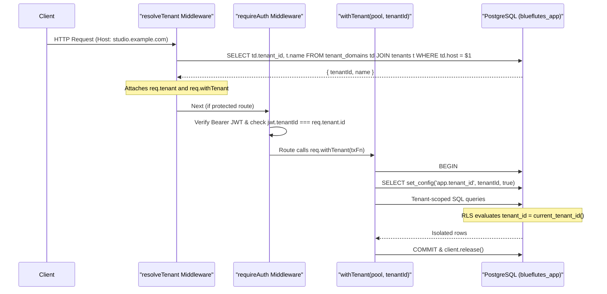
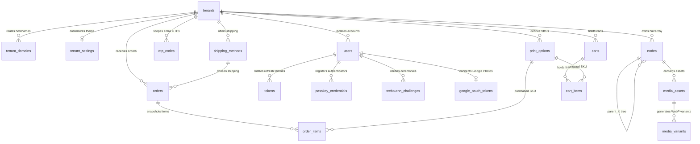

# 02 — Database Schema & Multi-Tenancy (PostgreSQL 16 + Drizzle + RLS)

Every piece of tenant data in Portfolix lives in a **shared PostgreSQL 16 schema** protected at the database engine level by **Row-Level Security (RLS)**. Even if an application query accidentally forgets a `WHERE tenant_id = ...` clause, PostgreSQL itself refuses to return or mutate rows belonging to another tenant.

---

## 1. Defense-in-Depth Tenant Isolation

Tenant isolation relies on four interlocking guarantees enforced at boot and on every query:

1. **Host-Based Tenant Resolution (`apps/api/src/middleware/resolve-tenant.ts`)**:
   - Reads `req.headers.host`, normalizes it via `normalizeHost()` (lowercased, port stripped, IPv6 bracket-safe), and queries `findTenantByHost()` (`tenant_domains JOIN tenants WHERE td.host = $1`).
   - Does **not** trust `X-Forwarded-Host` or client-sent tenant IDs.
   - Missing or unregistered hosts return a uniform `404` (`Tenant not found for this host`).
2. **Permissive Bootstrap Read Policies (`0001_rls_policies.sql` & `0019_tenant_read_resolution.sql`)**:
   - Because `findTenantByHost()` runs *before* `app.tenant_id` is set, both `tenant_domains` (`tenant_domains_read_for_resolution`) and `tenants` (`tenants_read_for_resolution`) carry `FOR SELECT USING (true)` policies solely for host resolution, while `INSERT`, `UPDATE`, and `DELETE` remain locked to `current_tenant_id()`.
3. **Fail-Closed Per-Transaction GUC (`apps/api/src/db/with-tenant.ts`)**:
   - `withTenant(pool, tenantId, callback)` validates `tenantId` as a UUID, acquires a pooled client, starts a `BEGIN` transaction, and executes:
     ```sql
     SELECT set_config('app.tenant_id', $1, true)
     ```
   - Passing `true` makes the setting **transaction-local** (`SET LOCAL` semantics), so pooled connections (including PgBouncer / Supabase Supavisor transaction pooling on port `6543`) never leak `app.tenant_id` across requests.
   - All tenant RLS policies check `tenant_id = current_tenant_id()` where:
     ```sql
     CREATE FUNCTION current_tenant_id() RETURNS uuid LANGUAGE sql STABLE AS $$
       SELECT NULLIF(current_setting('app.tenant_id', true), '')::uuid
     $$;
     ```
   - When `app.tenant_id` is unset or `''`, `current_tenant_id()` returns `NULL`. Since `tenant_id = NULL` evaluates to `UNKNOWN`, policies **fail closed** and return zero rows.
4. **Restricted Runtime Role & Boot Guards (`apps/api/src/db/assert-runtime-role.ts`)**:
   - Every tenant-scoped table enables **`FORCE ROW LEVEL SECURITY`**, meaning even table owners are bound by RLS policies.
   - Runtime pools (`DATABASE_URL`) must connect as `blueflutes_app` (`NOSUPERUSER`, `NOBYPASSRLS`, provisioned by `src/scripts/bootstrap-roles.ts`).
   - On server startup (`src/index.ts`), `assertRuntimeRoleSafe()` and `assertTenantTablesRlsEnforced()` refuse to boot if the connected role has `rolsuper`/`rolbypassrls` or if core tenant tables lack `FORCE ROW LEVEL SECURITY`.



---

## 2. Complete Entity-Relationship Diagram (All 18 Tables)



---

## 3. Table-by-Table Schema Dictionary

All Drizzle schemas live in [`apps/api/src/db/schema/`](../apps/api/src/db/schema/index.ts).

### 3.1 Multi-Tenancy & Presentation

1. **`tenants`** (`schema/tenants.ts`)
   - `id` (`uuid PK`), `name` (`text`), `status` (`'active' | 'suspended'`), `created_at`, `updated_at`.
   - **RLS**: `id = current_tenant_id()` + `tenants_read_for_resolution` (`FOR SELECT USING (true)`).
2. **`tenant_domains`** (`schema/tenant-domains.ts`)
   - `id` (`uuid PK`), `tenant_id` (`uuid FK -> tenants`), `host` (`text`), `is_primary` (`boolean`), `created_at`.
   - **Indexes**: Unique index `tenant_domains_host_idx` on `host`.
   - **RLS**: Permissive `SELECT` for host resolution; writes restricted to `tenant_id = current_tenant_id()`.
3. **`tenant_settings`** (`schema/tenant-settings.ts`)
   - `tenant_id` (`uuid PK -> tenants`), `color_bg` (`#f4f3f0`), `color_ink` (`#16150f`), `color_accent` (`#c0683f`), `color_muted` (`#6b6960`), `font_heading` (`newsreader`), `font_body` (`hanken`), `gallery_layout` (`grid`), `grid_columns` (`5`), `created_at`, `updated_at`.
   - **RLS**: `tenant_id = current_tenant_id()`.

### 3.2 Users, Auth & Integrations

4. **`users`** (`schema/users.ts`)
   - `id` (`uuid PK`), `tenant_id` (`uuid FK -> tenants`), `email` (`text`), `display_name` (`text`), `avatar_url` (`text?`), `created_at`, `updated_at`.
   - **Indexes**: Unique index `users_tenant_email_idx` on `(tenant_id, email)`—the same email can belong independently to different tenants.
   - **RLS**: `tenant_id = current_tenant_id()`.
5. **`tokens`** (`schema/tokens.ts`)
   - Stores SHA-256 hashed refresh tokens in rotation families: `id`, `tenant_id`, `user_id`, `family_id` (`uuid`), `hashed_token`, `rotated_to` (`uuid?`), `revoked_at`, `expires_at`, `created_at`, `user_agent`, `ip`.
   - **Indexes**: `tokens_family_id_idx` on `family_id` for O(1) family revocation on reuse detection.
   - **RLS**: `tenant_id = current_tenant_id()`.
6. **`otp_codes`** (`schema/otp-codes.ts`)
   - Short-lived passwordless sign-in codes: `id`, `tenant_id`, `email`, `code_hash` (SHA-256 of 6-digit PIN), `expires_at`, `used_at`, `attempts` (default `0`), `ip`, `created_at`.
   - **RLS**: `tenant_id = current_tenant_id()`; `blueflutes_app` has `SELECT, INSERT, UPDATE` only.
7. **`passkey_credentials`** (`schema/passkeys.ts`)
   - WebAuthn authenticators: `id`, `tenant_id`, `user_id`, `credential_id` (base64url), `public_key` (COSE hex), `counter` (`bigint`), `device_type`, `backed_up`, `transports`, `aaguid`, `friendly_name`, `last_used_at`, `created_at`.
   - **Indexes**: Unique on `(tenant_id, credential_id)`, index on `(tenant_id, user_id)`.
8. **`webauthn_challenges`** (`schema/passkeys.ts`)
   - Ephemeral 5-minute single-use WebAuthn challenges: `id`, `tenant_id`, `user_id?`, `challenge`, `type` (`'registration' | 'authentication'`), `expires_at`, `used_at`, `ip`, `created_at`.
9. **`google_oauth_tokens`** (`schema/google-oauth-tokens.ts`)
   - Stores Google OAuth tokens per `(tenant_id, user_id)`: `id`, `tenant_id`, `user_id`, `access_token`, `refresh_token?`, `expires_at`, `scopes`, `created_at`, `updated_at`.
   - **Constraint**: `UNIQUE (tenant_id, user_id)`.

### 3.3 Hierarchical Content Tree & Media

10. **`nodes`** (`schema/nodes.ts`)
    - Models folders, galleries, and pages as an adjacency list (`parent_id` self-FK with `ON DELETE CASCADE`):
      `id`, `tenant_id`, `parent_id?`, `type` (`'folder' | 'gallery' | 'page'`), `name`, `slug`, `position`, `google_album_id?`, `share_token` (`uuid UNIQUE`), `password_hash?` (`pbkdf2:<salt>:<hash>`), `is_password_protected` (`boolean`), `created_at`, `updated_at`.
    - **Indexes**:
      - `nodes_tenant_parent_idx` on `(tenant_id, parent_id)`
      - `nodes_tenant_parent_slug_idx` unique on `(tenant_id, parent_id, slug)`
      - `nodes_tenant_root_slug_idx` partial unique on `(tenant_id, slug) WHERE parent_id IS NULL`
      - Partial indexes on `google_album_id` and `share_token`
11. **`media_assets`** (`schema/media-assets.ts`)
    - Stores object-storage references and metadata (**never** binary image blobs):
      `id`, `tenant_id`, `node_id` (`FK -> nodes`), `object_key`, `url`, `mime_type`, `status` (`'pending' | 'processing' | 'ready' | 'failed'` — seed rows may also carry `'published'`), `position`, `original_filename`, `byte_size`, `checksum?`, `width?`, `height?`, `google_media_item_id?`, `google_base_url?`, `thumbnail_url?`, `cached_url?`, `cached_until?`, `processing_error?`, `processing_at?`, `ready_at?`, `created_at`.
    - **Index**: `media_assets_tenant_node_position_idx` on `(tenant_id, node_id, position)`.
12. **`media_variants`** (`schema/media-variants.ts`)
    - Stores Sharp-generated WebP variant metadata when `getTransformUrl` is not used:
      `id`, `tenant_id`, `asset_id` (`FK -> media_assets`), `variant` (`'thumb' | 'small' | 'medium' | 'large'`), `object_key`, `url`, `width`, `height`, `byte_size`, `created_at`.
    - **Indexes**: Unique on `(asset_id, variant)`, index on `(tenant_id, asset_id)`.

### 3.4 Print Commerce (`schema/commerce.ts` & `0013_commerce.sql`)

> **Financial Integrity Rule:** Every monetary field in `print_options`, `cart_items`, `shipping_methods`, `orders`, and `order_items` is stored as an **integer in minor units (cents)** alongside a 3-letter ISO `currency` code (default `'USD'`), eliminating floating-point rounding drift. Checkout (`POST /checkout/session`) reads canonical `print_options.price` and `shipping_methods.price` server-side—client totals are never trusted.

13. **`print_options`**: `id`, `tenant_id`, `photo_id`, `size`, `kind`, `framed`, `price` (cents), `print_cost` (cents), `currency`, `edition_size?`, `edition_sold`, `created_at`.
14. **`carts`**: `id`, `tenant_id`, `user_id?`, `session_token?` (backed by `cart_session` httpOnly cookie), `currency`, `created_at`, `updated_at`.
15. **`cart_items`**: `id`, `cart_id` (`FK -> carts`), `photo_id`, `print_option_id` (`FK -> print_options`), `qty`, `unit_price` (cents), `created_at`. Inherits tenant isolation via parent `carts` RLS.
16. **`shipping_methods`**: `id`, `tenant_id`, `label`, `estimate`, `price` (cents), `currency`, `sort_order`.
17. **`orders`**: `id`, `number` (e.g. `BF-10482`), `tenant_id`, `buyer_email`, `buyer_name`, `buyer_user_id?`, `shipping_address_json` (`jsonb`), `shipping_method_id`, `shipping_price`, `subtotal`, `tax`, `total`, `currency`, `status` (default `'pending'`), `timeline_json`, `tracking_url?`, `order_token` (signed guest receipt link token), `payment_intent_id?`, `created_at`, `updated_at`.
18. **`order_items`**: `id`, `order_id` (`FK -> orders`), `photo_id`, `print_option_id`, `title`, `thumb_url`, `size`, `kind`, `qty`, `unit_price`, `print_cost`. Snapshot at checkout time so future SKU edits never mutate past receipts.

---

## 4. Sequential Migrations (`0000`–`0019`)

| Migration | Summary |
|---|---|
| `0000_sour_anthem.sql` | Initial `tenants`, `tenant_domains`, `users`, `tokens`, `nodes`, `media_assets` tables & indexes |
| `0001_rls_policies.sql` | `current_tenant_id()` + `ENABLE/FORCE ROW LEVEL SECURITY` on initial 6 tables |
| `0002_roles.sql` | `GRANT USAGE` + DML grants to `blueflutes_app` |
| `0003_jittery_morbius.sql` | `media_variants` table + media upload status/position/filename/size columns |
| `0004_media_variants_rls.sql` | RLS on `media_variants` |
| `0005_media_variants_grant.sql` | Role grants on `media_variants` |
| `0006_bored_unicorn.sql` | `media_variants.object_key`, `byte_size`, and variant unique indexes |
| `0007_real_dark_phoenix.sql` | Partial unique index `nodes_tenant_root_slug_idx` for root slugs |
| `0008_tenant_settings.sql` | `tenant_settings` theme & layout table |
| `0009_tenant_settings_rls.sql` | RLS on `tenant_settings` |
| `0010_tenant_settings_grant.sql` | Role grants on `tenant_settings` |
| `0011_rename_roles.sql` | Safe role rename from `portfoliohub_*` to `blueflutes_*` |
| `0012_muted_token_update.sql` | WCAG v2 `--color-muted` default update (`#6b6960`) |
| `0013_commerce.sql` | `print_options`, `carts`, `cart_items`, `shipping_methods`, `orders`, `order_items` + RLS + grants |
| `0014_google_photos.sql` | `google_oauth_tokens` table + `nodes.google_album_id` + `media_assets` Google columns + RLS + grants |
| `0015_gallery_password.sql` | `nodes.share_token`, `password_hash`, `is_password_protected` + backfill |
| `0016_media_processing_columns.sql` | `media_assets.processing_error`, `processing_at`, `ready_at` |
| `0017_otp_codes.sql` | `otp_codes` table + RLS + `blueflutes_app` grants |
| `0018_passkeys.sql` | `passkey_credentials` and `webauthn_challenges` tables + RLS + grants |
| `0019_tenant_read_resolution.sql` | `tenants_read_for_resolution` permissive SELECT policy for `findTenantByHost()` |

### Authoring a New Tenant-Scoped Table

Whenever you add a new table with `tenant_id`:
1. Add the Drizzle table in `apps/api/src/db/schema/` and re-export it from `apps/api/src/db/schema/index.ts`.
2. Generate SQL with `pnpm --filter @blueflutes/api db:generate` (or create a numbered `.sql` file matching `drizzle-kit`).
3. Ensure the migration includes **all three** security steps:
   ```sql
   ALTER TABLE "your_table" ENABLE ROW LEVEL SECURITY;
   ALTER TABLE "your_table" FORCE ROW LEVEL SECURITY;
   CREATE POLICY tenant_isolation ON "your_table"
     USING ("tenant_id" = current_tenant_id())
     WITH CHECK ("tenant_id" = current_tenant_id());
   GRANT SELECT, INSERT, UPDATE, DELETE ON "your_table" TO blueflutes_app;
   ```
4. If the table holds critical tenant assets, add its name to `TENANT_SCOPED_TABLES` in [`apps/api/src/db/assert-runtime-role.ts`](../apps/api/src/db/assert-runtime-role.ts) and add isolation tests under `apps/api/test/`.

