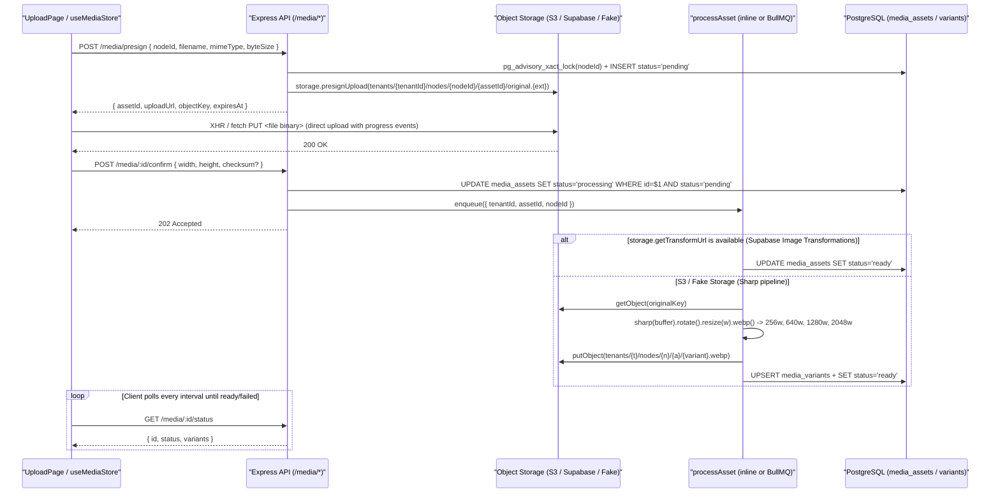
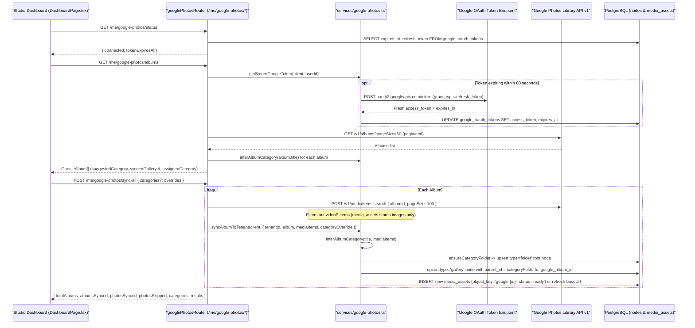

# 03 — Media Processing & Google Photos Auto-Categorization Pipeline

Portfolix supports two ingestion pipelines that both converge into the same `nodes` hierarchy and `media_assets` / `media_variants` read API:

1. **Direct-to-Storage Upload + Sharp / Transform Variant Pipeline** (`POST /media/presign` -> `PUT` -> `POST /media/:id/confirm`).
2. **Google Photos Album Pull + Rule-Based Auto-Categorization Engine** (`/me/google-photos/*` & `/me/galleries/auto-categorize`).

---

## 1. Direct-to-Storage Upload & Variant Processing

Image binaries **never** pass through Express or PostgreSQL. Clients upload directly to object storage (`S3` / `MinIO` / `Supabase Storage`), while Express coordinates metadata, advisory locks, and responsive variant assembly.

### 1.1 Key Code Files & Design Details

- **Storage Provider Strategy ([`apps/api/src/services/storage/`](../apps/api/src/services/storage/index.ts))**:
  - `S3StorageProvider` (`s3-provider.ts`): Uses `@aws-sdk/client-s3` + `getSignedUrl` for standard S3, Cloudflare R2, MinIO, or Supabase S3 endpoints.
  - `SupabaseStorageProvider` (`supabase-provider.ts`): Uses Supabase S3-compatible uploads **plus** implements `getTransformUrl(key, width, quality)` pointing at `/storage/v1/render/image/public/...`, allowing `processAsset()` to skip `sharp` transcoding and build variants synthetically at read time.
  - `FakeStorageProvider` (`fake-provider.ts`): Used when `STORAGE_PROVIDER=fake` in tests and offline dev.
- **Advisory Position Locking ([`apps/api/src/routes/media.ts`](../apps/api/src/routes/media.ts))**:
  - `POST /media/presign`, `DELETE /media/:id`, and `PATCH /media/:id/move` acquire `SELECT pg_advisory_xact_lock(hashtext($1))` keyed by `nodeId` inside `withTenant`. This prevents concurrent uploads, deletions, or drag-and-drop reorders from creating duplicate or gapped `position` integers.
- **Responsive Variant Specifications ([`apps/api/src/services/media/variant-specs.ts`](../apps/api/src/services/media/variant-specs.ts))**:
  - Generates four WebP breakpoints (`withoutEnlargement: true`, always emitting `thumb`):
    - `thumb`: `256px`
    - `small`: `640px`
    - `medium`: `1280px`
    - `large`: `2048px`
- **Queue Modes ([`apps/api/src/services/media/queue.ts`](../apps/api/src/services/media/queue.ts) & [`worker.ts`](../apps/api/src/services/media/worker.ts))**:
  - `QUEUE_PROVIDER=inline` (default, ideal for Vercel serverless): `processAsset()` executes synchronously during `/confirm` (up to Vercel's `60s` `maxDuration`).
  - `QUEUE_PROVIDER=bullmq` (requires `REDIS_URL`): Enqueues `'process-asset'` onto the `'media-processing'` queue (`attempts: 3`, exponential backoff `2000ms`), processed by `worker.ts` (`concurrency: 4`), which invalidates `gallery:${tenantId}:${nodeId}` and writes `job:status:${assetId}` in Redis for fast polling.
- **Client Rendering & Blur-Up ([`apps/web/src/components/ui/ResponsiveImage.tsx`](../apps/web/src/components/ui/ResponsiveImage.tsx))**:
  - Builds `` sorted by ascending width, renders the `256w` `thumb` behind the main image with `filter: blur(12px)` as a Low-Quality Image Placeholder (LQIP) until `onLoad` fades in opacity, and covers the image with a `.photo-protected` transparent `` to deter right-click/drag downloads.

---

## 2. Google Photos Album Pull & Auto-Categorization Engine

Photographers can connect their Google Photos library to pull albums directly into categorized galleries on the Studio Dashboard without re-uploading large files.

### 2.1 How Auto-Categorization Works (`inferAlbumCategory`)

Implemented in [`apps/api/src/services/google-photos.ts`](../apps/api/src/services/google-photos.ts), `inferAlbumCategory(albumTitle, mediaItems)` classifies every album into one of the 10 canonical `PHOTO_CATEGORIES` exported by `@blueflutes/shared`:

`City` · `Landscape` · `Portrait` · `Family` · `B&W` · `Street` · `Travel` · `Events` · `Wildlife` · `Architecture`

**Scoring Algorithm:**
1. **Album Title Match (`+10 pts` per regex pattern hit)**: Normalizes `_` and `-` to spaces and tests against curated domain keyword rules (e.g., `gbtb` / `marina` -> `City`, `catrip` / `tokyo` -> `Travel`, `diwali` / `wedding` -> `Events`, `familyshoot` -> `Family`).
2. **Media Filenames & Descriptions (`+2 pts` per hit)**: Scans each photo's `filename` and `description` against the same `CATEGORY_RULES` table so generically named albums (e.g., `"October Export"`) still classify accurately when filenames contain clues.
3. **Aspect-Ratio Fallback**: If no keyword rule matches at all, counts portrait (`height > width * 1.1`) vs landscape (`width > height * 1.2`) dimensions—falling back to `'Portrait'`, `'Landscape'`, or finally `'City'`.

### 2.2 Hierarchy & Public Viewer Integration

- When [`syncAlbumToTenant()`](../apps/api/src/services/google-photos.ts) or [`POST /me/galleries/auto-categorize`](../apps/api/src/routes/galleries.ts) classifies a gallery:
  1. `ensureCategoryFolder()` finds or creates a root folder node (`type = 'folder'`, `parent_id IS NULL`) matching the category name.
  2. `assignGalleryCategory()` sets the gallery node's `parent_id = categoryFolderId`, safely disambiguating slugs if two albums share a name under that folder.
- On read (`GET /media?nodeId=...`), any asset whose `object_key` starts with `'google:'` bypasses `media_variants` DB lookups and calls `buildSyntheticVariants()`, appending Google Photos resize parameters (`${baseUrl}=w256`, `=w640`, `=w1280`, `=w2048`).
- In [`PortfolioViewer.tsx`](../apps/web/src/pages/viewer/PortfolioViewer.tsx), `getAllGalleryNodes()` walks the `/nodes` tree and assigns each gallery's parent folder name as its category chip in the public portfolio grid automatically.

> [!NOTE]
> **Google OAuth Token Status:** Following the migration from social OAuth to Email OTP + Passkeys for Studio login (`apps/api/src/routes/auth.ts`), the Dashboard and Upload views still link to `/api/auth/google?next=...` for first-time Google Photos linking. Once a `google_oauth_tokens` row exists for the user, `getStoredGoogleToken()` automatically refreshes expired tokens using `GOOGLE_CLIENT_ID` and `GOOGLE_CLIENT_SECRET`. Adding a standalone authenticated `/me/google-photos/connect` OAuth initiator for fresh browser linking is tracked as a follow-up task.

