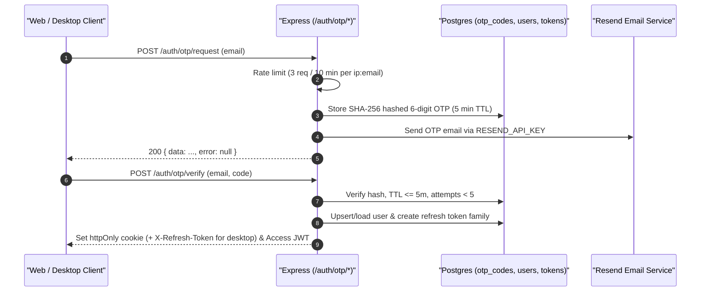

# 04 — API & Authentication Contracts

This document details the HTTP API surface, middleware execution pipeline, passwordless authentication flows (Email OTP and WebAuthn Passkeys), session lifecycle, multi-tenant guards, and validated environment configuration for `@blueflutes/api`.

---

## 1. Request Lifecycle & Middleware Stack

In `apps/api/src/app.ts`, `createApp()` constructs the Express 4 application with a deterministic middleware chain before mounting the 21 domain routers. When deployed on Vercel (`api/[...path].ts`), the `/api` prefix is stripped before handing the request to `app`.

```mermaid
flowchart LR
  Req["Incoming HTTP Request"] --> Sec["security-headers.ts (Helmet CSP & HSTS)"]
  Sec --> Log["request-logging.ts (pino-http)"]
  Log --> Health["GET /health (Pre-Tenant Health Probe)"]
  Health --> Tenant["resolve-tenant.ts (findTenantByHost)"]
  Tenant --> Cors["cors.ts (CORS_ALLOWED_ORIGINS)"]
  Cors --> RL["rate-limit.ts (Auth & Write Limiters)"]
  RL --> Router["Mounted Express Router"]
  Router -->|"Protected Route"| Auth["require-auth.ts (HS256 JWT + tenantId Match)"]
  Auth --> Tx["withTenant(pool, tenantId, fn)"]
  Router -->|"Public Route"| Tx
  Tx --> Err["error-handler.ts (AppError & Zod Formatter)"]
  Err --> Env["JSON Envelope { data, error }"]
```

### Startup Security Assertions

Before `apps/api/src/index.ts` binds `env.PORT`, it runs two mandatory database safety assertions from `apps/api/src/db/assert-runtime-role.ts`:

1. `assertRuntimeRoleSafe(pool)` — verifies the runtime connection does not hold `SUPERUSER` or `BYPASSRLS` privileges so Row-Level Security (RLS) cannot be bypassed accidentally.
2. `assertTenantTablesRlsEnforced(pool)` — verifies RLS is enabled and forced across tenant-scoped tables.

### Standard Response Envelope & Errors

All API handlers use the shared `{ data, error }` envelope defined in `packages/shared/src/envelope.ts` and throw typed `AppError` instances (`apps/api/src/lib/app-error.ts`) caught by `apps/api/src/middleware/error-handler.ts`.

- **Success**: HTTP `2xx` with `{ "data": <payload>, "error": null }`
- **Failure**: HTTP `4xx` / `5xx` with `{ "data": null, "error": { "code": "<ERROR_CODE>", "message": "<human-readable message>", ... } }`

---

## 2. Multi-Tenant Resolution & Auth Guards

### Host-Based Tenant Resolution (`resolve-tenant.ts`)

`apps/api/src/middleware/resolve-tenant.ts` resolves the active tenant on every request using `findTenantByHost` (`apps/api/src/services/tenant-resolution.ts`):

- Performs a **strict host lookup** via `tenant_domains JOIN tenants WHERE td.host = $1`.
- There is **no** subdomain-slug fallback and **no** `DEFAULT_TENANT_SLUG` fallback—unrecognized hosts fail tenant resolution cleanly.
- Both `tenant_domains` and `tenants` expose permissive `FOR SELECT USING (true)` RLS policies (migrations `0001` and `0019`) so host resolution can occur before a tenant transaction context is opened.

### Authentication Guard (`require-auth.ts`)

`requireAuth` (`apps/api/src/middleware/require-auth.ts`) protects private Studio and user routes:

1. Extracts the Bearer access JWT from the `Authorization` header.
2. Verifies the HS256 signature and expiration (`JWT_SECRET`, `apps/api/src/lib/jwt.ts`).
3. Enforces cross-tenant token isolation by verifying `payload.tenantId === req.tenant.id`.
4. Note: `require-auth.ts` enforces authenticated tenant membership; there is currently no separate `requireRole` RBAC middleware.

---

## 3. Authentication & Session Architecture

Studio authentication uses passwordless **Email OTP** (`apps/api/src/routes/auth.ts`, `apps/api/src/services/otp.ts`) and **WebAuthn Passkeys** (`apps/api/src/routes/passkeys.ts`, `apps/api/src/services/passkeys.ts`) paired with short-lived access JWTs and rotating refresh token families (`apps/api/src/lib/refresh-tokens.ts`).

### 3.1 Email OTP Flow

OTP parameters are defined in `apps/api/src/services/otp.ts`:
- **Code Format**: 6-digit numeric string (`randomInt(0, 1_000_000)` zero-padded), stored hashed via SHA-256 (`hashOtpCode`) in `otp_codes`.
- **Expiration**: `OTP_TTL_MS = 5 * 60 * 1000` (**5 minutes**).
- **Attempt Limit**: `OTP_MAX_ATTEMPTS = 5` verification attempts before invalidation.
- **Request Rate Limit**: `OTP_REQUEST_MAX = 3` requests per `OTP_REQUEST_WINDOW_MS = 10 * 60 * 1000` (**10 minutes**) keyed by `${ip}:${email}`.

### 3.2 WebAuthn Passkey Flow (`@simplewebauthn/server`)

Mounted via `apps/api/src/routes/passkeys.ts` at `/auth/passkey/*`, backed by `passkey_credentials` and `webauthn_challenges` (`apps/api/src/db/schema/passkeys.ts`) with single-use `'registration'` and `'authentication'` challenge helpers (`createChallenge` / `consumeChallenge`):

- Relying Party configuration comes from `WEBAUTHN_RP_ID` (default `'localhost'`), `WEBAUTHN_RP_NAME` (default `'Blueflutes'`), and `WEBAUTHN_ORIGINS` (default `'http://localhost:5173'`).
- **Registration** (authenticated user): `beginRegistration` issues WebAuthn creation options and stores a single-use challenge; `finishRegistration` consumes the challenge, verifies the attestation response, and persists the credential (with optional `friendlyName`) to `passkey_credentials`.
- **Authentication** (sign-in): `beginAuthentication` issues assertion options for the tenant (optionally scoped by `email`); `finishAuthentication` consumes the challenge, validates the assertion signature and counter, and issues an access JWT + refresh token session.
- **Credential Management**: Authenticated users can list, rename (`friendlyName`), and delete registered passkey credentials via `listCredentials`, `renameCredential`, and `deleteCredential`.

### 3.3 Rotating Refresh Token Families

- **Access Token**: Short-lived HS256 JWT (`JWT_ACCESS_TOKEN_TTL_SECONDS`, default `900` seconds / 15 minutes). Kept in client memory (`apps/web/src/stores/auth-store.ts`), never written to `localStorage`.
- **Refresh Token**: Long-lived token (`REFRESH_TOKEN_TTL_DAYS`, default `30` days) tracked by token family in `tokens` (`apps/api/src/lib/refresh-tokens.ts`). Each refresh rotates the token and revokes reuse of stale tokens within the family.
- **Transport Split**:
  - **Browser Web App**: Stored in an `httpOnly` cookie (`apps/api/src/lib/cookies.ts`) scoped to `AUTH_COOKIE_PATH` (`/auth` locally, `/api/auth` behind Vercel rewrites).
  - **Desktop App (Tauri v2)**: Uses `X-Refresh-Token` header transport and OS keychain persistence (`apps/web/src/lib/secure-storage.ts`), because custom protocol origins do not share third-party `httpOnly` cookies reliably.

### 3.4 Google Photos OAuth Status

- Interactive Studio login no longer uses Google OAuth (`apps/api/src/routes/auth.ts` does **not** mount `/auth/google`; Studio sign-in is Email OTP + Passkeys).
- For accounts that already have stored credentials in `google_oauth_tokens`, `getStoredGoogleToken()` (`apps/api/src/services/google-photos.ts`) refreshes expired access tokens automatically using `GOOGLE_CLIENT_ID` and `GOOGLE_CLIENT_SECRET`.
- **Current Gap**: Studio Dashboard/Upload UI components still surface links to `/api/auth/google?next=...`; see [03 — Media & Google Photos Pipeline](./03-MEDIA-AND-GOOGLE-PHOTOS-PIPELINE.md) and [05 — Developer Setup & Runbook](./05-DEVELOPER-SETUP-AND-RUNBOOK.md) for current integration status.

---

## 4. API Router Reference

All 21 route modules live under `apps/api/src/routes/`. They fall into two categories: **DB-Backed Production Routes** (running inside `withTenant` against PostgreSQL) and **Phase 1/2 Scaffold Routes** (returning structured mock/placeholder responses ahead of dedicated persistence tables).

### 4.1 Core Auth, Health & Tenant Routes (DB-Backed)

| Router File | Base / Endpoints | Auth | Purpose |
| :--- | :--- | :--- | :--- |
| `health.ts` | Health & readiness probes | Public | Verifies API liveness and database connectivity. |
| `auth.ts` | `/auth/otp/*`, refresh, logout | Mixed | Email OTP request/verify, rotating refresh token rotation, logout. |
| `passkeys.ts` | `/auth/passkey/*` | Mixed | WebAuthn passkey registration, sign-in, list/rename/delete credentials. |
| `me.ts` | `/me/*` | `requireAuth` | Authenticated user profile (DB-backed) and account settings (note: secondary settings sub-routes remain Phase 1/2 scaffold stubs). |
| `tenant-settings.ts` | Tenant branding & configuration | Public read / `requireAuth` write | Reads and updates `tenant_settings` for the active host tenant. |

### 4.2 Portfolio, Media & Google Photos Routes (DB-Backed)

| Router File | Key Endpoints & Scope | Auth | Purpose |
| :--- | :--- | :--- | :--- |
| `nodes.ts` | Node tree reads | Public / scoped | Queries hierarchical portfolio tree (`nodes` table). |
| `nodes-write.ts` | Node create, update, reorder, delete | `requireAuth` | Writes hierarchical portfolio tree nodes (`nodes` table). |
| `galleries.ts` | Studio gallery CRUD & publishing | `requireAuth` | Manages studio galleries and visibility/share tokens. |
| `media.ts` | `/media/*`, `DELETE /media/:id` | `requireAuth` | Presigned S3/Supabase uploads, finalize/variant processing (`Sharp` + `BullMQ`/inline), asset metadata, and cascading delete with post-commit `storage.deleteObject`. |
| `google-photos.ts` | Google Photos connection, albums, import & auto-categorize | `requireAuth` | Lists remote albums, imports media into storage/DB, and runs auto-categorization into portfolio nodes/galleries. |
| `client-gallery.ts` | Client proofing share-token routes | Public / Share Token | Serves client proofing galleries by `shareToken`. |

### 4.3 Public Discovery Routes (DB-Backed)

| Router File | Path(s) | Auth | Purpose |
| :--- | :--- | :--- | :--- |
| `discover.ts` | `GET /discover/fresh` | Public | Returns freshly published photography across tenant galleries. |
| `photographers.ts` | `GET /photographers/:handle/galleries`, `GET /photographers/:handle/photos` | Public | Resolves public photographer profile feeds by handle. |
| `photos.ts` | `GET /photos/:id` | Public | Retrieves single photo metadata and responsive variant URLs. |
| `search-route.ts` | `GET /search` | Public | Queries searchable public galleries/photos for the active tenant. |

### 4.4 Print Commerce Routes (DB-Backed)

Implemented in `apps/api/src/routes/commerce.ts`. All monetary columns (`price`, `printCost`, `unitPrice`, `subtotal`, `shippingPrice`, `tax`, `total`) are persisted and returned as **integer minor units (cents)**. Guest shopping carts use an `httpOnly` cookie named `cart_session` (not an `X-Cart-Session` request header).

| Method & Path | Purpose |
| :--- | :--- |
| `GET /photos/:id/print-options` | Returns available print SKUs/sizes and unit prices (in cents) for a photo. |
| `GET /cart` | Loads or initializes the current cart tied to `cart_session` cookie (or user). |
| `POST /cart/items` | Adds/updates a print item in the cart and recalculates integer totals. |
| `GET /checkout/shipping-methods` | Lists supported shipping methods and shipping costs (in cents). |
| `POST /checkout/session` | Creates a checkout session / pending order from the active cart. |
| `GET /orders/:id` | Fetches order confirmation and fulfillment status. |
| `POST /webhooks/payments` | Processes payment provider webhook callbacks to update order payment state. |

### 4.5 Phase 1/2 Scaffold Routes (Non-Persistent Placeholders)

The following routers in `apps/api/src/routes/` are currently scaffolded with structured placeholder data rather than full transactional DB tables:

- `analytics.ts` — Studio portfolio view/engagement metrics scaffold (`Studio AnalyticsPage`).
- `studio-orders.ts` — Studio order fulfillment list scaffold (`Studio OrdersPage`).
- `community.ts` — Community feed scaffold.
- `conversations.ts` — Client messaging / conversations scaffold.
- `plans.ts` — Subscription plans catalog scaffold.

---

## 5. Validated Environment Contract (`apps/api/src/config/env.ts`)

`env.ts` validates process environment variables at boot using Zod. Missing required variables or invalid URLs/integers cause immediate startup failure.

| Variable | Required / Default | Purpose |
| :--- | :--- | :--- |
| `NODE_ENV` | Optional (`development` / `production` / `test`) | Controls SSL cert verification (`rejectUnauthorized: false` only outside `production`), cookies, and logging behavior. |
| `PORT` | Default `3001` | Port bound by Express in standalone server mode (`apps/api/src/index.ts`). |
| `DATABASE_URL` | **Required** | PostgreSQL connection string for runtime queries (`blueflutes_app` role; in Supabase production, use transaction pooler port `6543`). |
| `DATABASE_MIGRATION_URL` | **Required** | Privileged PostgreSQL connection string used only for DDL migrations and bootstrapping (in Supabase production, use session pooler port `5432`). |
| `DATABASE_TEST_URL` | Optional | Runtime test DB URL for Vitest integration suites. |
| `DATABASE_TEST_MIGRATION_URL` | Optional | Migration test DB URL for Vitest test setup. |
| `DB_POOL_MAX` | Default `10` | Maximum connections in `pg.Pool` (set to `2` in Vercel serverless production). |
| `DB_POOL_IDLE_TIMEOUT_MS` | Default `30000` | Pool idle client timeout in milliseconds. |
| `DB_APP_ROLE` | Default `'blueflutes_app'` | Non-superuser runtime PostgreSQL role asserted at API startup. |
| `DB_APP_ROLE_PASSWORD` | Optional | Password used by `db:bootstrap-roles` when creating/updating `DB_APP_ROLE`. |
| `JWT_SECRET` | **Required** | Secret key for signing/verifying HS256 access tokens. |
| `JWT_ACCESS_TOKEN_TTL_SECONDS` | Default `900` | Access JWT lifetime in seconds (15 minutes). |
| `REFRESH_TOKEN_TTL_DAYS` | Default `30` | Rotating refresh token family lifetime in days. |
| `WEB_APP_URL` | Default `'http://localhost:5173'` | Primary web frontend base URL used in links and redirects. |
| `AUTH_COOKIE_PATH` | Default `'/auth'` | Path attribute on the refresh token `httpOnly` cookie (`'/api/auth'` in Vercel production). |
| `CORS_ALLOWED_ORIGINS` | Default `''` | Comma-separated origin allowlist evaluated by `cors.ts`. |
| `RESEND_API_KEY` | **Required** | API key for sending transactional Email OTP verification codes via Resend. |
| `RESEND_FROM_EMAIL` | Default `'noreply@blueflutes.app'` | Verified sender email address for OTP messages. |
| `WEBAUTHN_RP_ID` | Default `'localhost'` | WebAuthn Relying Party ID (must match production domain, e.g., `portfolix.tinkeryard.dev`). |
| `WEBAUTHN_RP_NAME` | Default `'Blueflutes'` | Human-readable Relying Party display name for passkey prompts. |
| `WEBAUTHN_ORIGINS` | Default `'http://localhost:5173'` | Comma-separated expected WebAuthn origins. |
| `QUEUE_PROVIDER` | `'inline'` \| `'bullmq'` (`'inline'` default) | Selects synchronous inline Sharp processing or Redis-backed BullMQ worker queue. |
| `REDIS_URL` | Optional (required if `QUEUE_PROVIDER=bullmq`) | Redis connection URL for BullMQ media jobs. |
| `STORAGE_PROVIDER` | `'fake'` \| `'s3'` \| `'supabase'` | Selects storage backend adapter (`apps/api/src/services/storage/`). |
| `STORAGE_BUCKET` | Optional | Object storage bucket name (e.g., `Portfolix`). |
| `STORAGE_REGION` | Optional | S3/storage region (e.g., `ap-southeast-1`). |
| `STORAGE_ENDPOINT` | Optional | Custom S3-compatible endpoint (MinIO locally or Supabase S3 endpoint). |
| `STORAGE_ACCESS_KEY_ID` | Optional | Access key for S3/MinIO storage adapter. |
| `STORAGE_SECRET_ACCESS_KEY` | Optional | Secret key for S3/MinIO storage adapter. |
| `STORAGE_PUBLIC_BASE_URL` | Optional | Public CDN/object base URL used to construct responsive image variant URLs. |
| `SUPABASE_URL` | Optional | Supabase project base URL when using the `supabase` storage provider. |
| `GOOGLE_CLIENT_ID` | Optional | Google OAuth client ID used when refreshing/connecting Google Photos tokens. |
| `GOOGLE_CLIENT_SECRET` | Optional | Google OAuth client secret. |
| `MEDIA_MAX_UPLOAD_BYTES` | Default `52428800` | Maximum allowed upload size per asset in bytes (50 MiB). |
| `MEDIA_PRESIGN_TTL_SECONDS` | Default `300` | Presigned upload URL expiration in seconds (5 minutes). |
