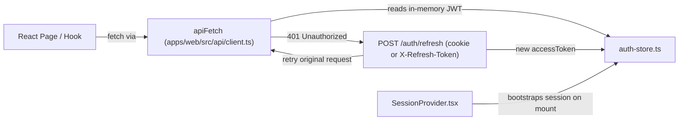

# 06 — Frontend Architecture & User Manual

This guide covers two audiences:
- **Part A (Frontend Code Walkthrough)**: React 18 + Vite + Tailwind CSS v4 architecture, routing, state management, API client/auth refresh, styling tokens, and image protection in `apps/web`.
- **Part B (Application User Manual)**: End-to-end workflows for public visitors, print buyers, proofing clients, and Studio photographers.

---

## Part A: Frontend Code Walkthrough (`@blueflutes/web`)

### 1. Core Stack & Entrypoint (`apps/web`)

- **Framework**: React 18 (`^18.3.1`), React Router v6 (`^6.28.0`), Vite, TypeScript.
- **Bootstrap (`apps/web/src/main.tsx`)**:
  - Mounts the React root inside `<ThemeProvider>` and `<SessionProvider>`, configured with the shared TanStack `QueryClient` (`apps/web/src/lib/query-client.ts`).
  - Registers document-level **capture-phase listeners** to deter unauthorized saving/dragging of protected portfolio photographs (`.photo-protected`).
- **Styling (`apps/web/src/index.css`)**:
  - Tailwind CSS v4 `@theme` design tokens and `.photo-protected` utility rules (`user-select: none`, drag/callout restrictions). Historical design handoff notes and design tokens are archived under [docs/design/design-system-overview.md](./design/design-system-overview.md).

### 2. Routing Table (`apps/web/src/App.tsx`)

| Route Pattern | Surface | Module / Notes |
| :--- | :--- | :--- |
| `/`, `/p/*`, `/portfolio/:handle` | Public Portfolio Viewer | `apps/web/src/pages/viewer/PortfolioViewer.tsx` — browses public portfolio hierarchy, galleries, and photography. |
| `/client/:shareToken`, `/gallery/:shareToken` | Client Proofing Gallery | `apps/web/src/features/client/ClientGalleryPage.tsx` — token-gated client review & favorites/selection view. |
| `/cart`, `/checkout`, `/orders/:id` | Print Commerce | `apps/web/src/features/checkout/CartPage.tsx` and checkout/order confirmation views backed by `cartStore`. |
| `/login` | Studio Sign-In | `apps/web/src/pages/login/Login.tsx` — passwordless Email OTP and WebAuthn Passkey authentication. |
| `/dashboard` | Legacy Redirect | Redirects automatically to `/studio/dashboard`. |
| `/studio/dashboard` | Studio Overview & Google Photos Sync | `apps/web/src/features/studio/DashboardPage.tsx` — workspace summary, **Pull All & Auto-Categorize**, and **Auto-Categorize Existing** controls. |
| `/studio/upload` | Media Uploader | `apps/web/src/features/studio/UploadPage.tsx` — presigned direct upload & processing pipeline. |
| `/studio/builder` | Gallery & Tree Builder | `apps/web/src/features/studio/GalleryBuilderPage.tsx` — manages portfolio tree hierarchy (`nodes`) and gallery ordering. |
| `/studio/orders` | Studio Orders | `apps/web/src/features/studio/OrdersPage.tsx` — order management view (currently backed by Phase 1/2 scaffold API `/studio-orders`). |
| `/studio/analytics` | Studio Analytics | `apps/web/src/features/studio/AnalyticsPage.tsx` — performance dashboard (currently backed by Phase 1/2 scaffold API `/analytics`). |
| `/studio/settings/*` | Studio & Tenant Settings | Account, passkey credential management, and tenant branding configuration routes. |

### 3. API Transport, Silent Refresh & Session Hydration

- **`apps/web/src/api/client.ts` (`apiFetch`)**:
  - Prepends `VITE_API_BASE_URL` (empty or direct URL locally; `/api` behind Vercel rewrites).
  - Attaches the in-memory Bearer access token from `auth-store.ts` and unwraps `{ data, error }` envelopes cleanly.
  - On `401`, performs deduplicated silent token refresh before retrying the failed request once.
- **`apps/web/src/api/*.ts`**: Domain-specific typed request modules (including `apps/web/src/api/auth.ts`).
- **`apps/web/src/auth/SessionProvider.tsx`**: Hydrates initial authentication state on load (using cookie refresh on web or OS keychain refresh token via `apps/web/src/lib/secure-storage.ts` on Tauri desktop, detected via `apps/web/src/lib/platform.ts`).

### 4. Client State Architecture (Zustand + TanStack Query)

- **TanStack Query (`apps/web/src/lib/query-client.ts`)**:
  - Exports the central query-key factory `qk` and shared default `queryClient` options for server cache invalidation across galleries, nodes, media, and commerce queries.
- **Zustand Stores (`apps/web/src/stores/`)**:
  - `auth-store.ts`: Holds in-memory `accessToken` and authenticated user state (never written to `localStorage`).
  - `nodes-store.ts`: Manages hierarchical portfolio tree state (`nodes`) and selection state for the Studio builder and viewer.
  - `media-store.ts`: Tracks active uploads, processing status, and media asset state in Studio views.
  - `cartStore.ts`: Holds guest/client print cart state synced with backend commerce endpoints (`cart_session` cookie).
  - `ui-store.ts`: Exports `useUiStore` (`sidebarOpen`, `toggleSidebar`, `setSidebarOpen`) for responsive Studio shell layout controls.

### 5. Responsive Images & Content Protection

- **`apps/web/src/components/ui/ResponsiveImage.tsx`**: Renders multi-width responsive variants generated by the Sharp media worker, selecting optimal `srcSet` candidates and applying `.photo-protected` styling to deter casual right-click/drag downloads on portfolio showcases.

---

## Part B: Application User Manual

### 1. Public Portfolio, Discovery & Lightbox

1. **Browsing Portfolios (`/`, `/p/*`, `/portfolio/:handle`)**: Visitors explore published portfolio categories, nested albums (`nodes`), and curated galleries tailored to the active tenant domain (`ThemeProvider`).
2. **Search & Discovery**: Visitors can browse freshly published works (`/discover/fresh`), search across public galleries/photos (`/search`), and view individual photographs in a high-resolution lightbox with responsive variants.

### 2. Purchasing Prints (`/cart`, `/checkout`, `/orders/:id`)

1. Open any photograph that exposes print options (`GET /photos/:id/print-options`) and add a print size/finish to the cart (`POST /cart/items`).
2. Guest shopping carts persist seamlessly across reloads via an `httpOnly` `cart_session` cookie.
3. Review items in `/cart`, choose a shipping method on `/checkout`, create a checkout session, and track status on `/orders/:id`.

### 3. Client Proofing (`/client/:shareToken`, `/gallery/:shareToken`)

1. Studio photographers generate a private `shareToken` for client galleries.
2. Clients open the share link directly in a browser without needing a Studio account, review proofs, and curate selections.

### 4. Studio CMS Workflows (`/studio/*`)

1. **Sign In (`/login`)**:
   - Enter your email to receive a 6-digit **Email OTP** (valid for 5 minutes via Resend).
   - Once signed in, enroll a **WebAuthn Passkey** under Studio Settings for one-tap biometric/hardware login on future visits.
2. **Dashboard & Google Photos Sync (`/studio/dashboard`)**:
   - Inspect portfolio activity and use **Pull All & Auto-Categorize** to import connected Google Photos albums and classify media into portfolio categories/nodes, or run **Auto-Categorize Existing** on previously imported media (see [03 — Media & Google Photos Pipeline](./03-MEDIA-AND-GOOGLE-PHOTOS-PIPELINE.md)).
   - *Note*: Interactive sign-in uses Email OTP/Passkeys; `/api/auth/google` is not mounted on `auth.ts` even though legacy connect links appear in Dashboard/Upload UI.
3. **Uploading Media (`/studio/upload`)**:
   - Drag and drop photographs for direct presigned upload (up to `MEDIA_MAX_UPLOAD_BYTES`, default 50 MiB), followed by automated Sharp variant generation.
4. **Building Galleries & Hierarchy (`/studio/builder`)**:
   - Organize tree nodes (categories/sub-portfolios), arrange gallery sequence, configure cover photos, and publish or share client proofing links.
5. **Orders, Analytics & Settings (`/studio/orders`, `/studio/analytics`, `/studio/settings/*`)**:
   - Configure tenant branding, manage registered passkey credentials (list, rename, revoke), and review order/analytics views.

